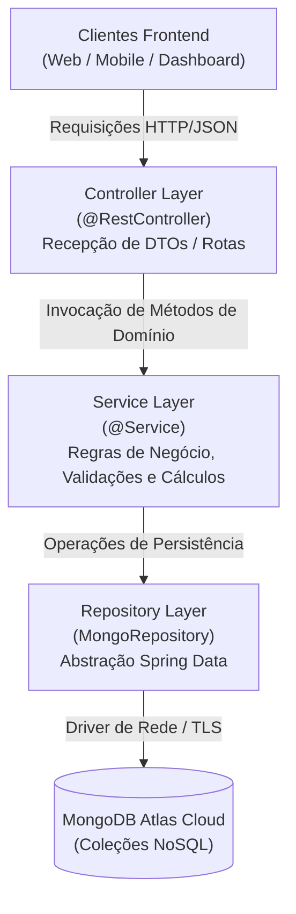
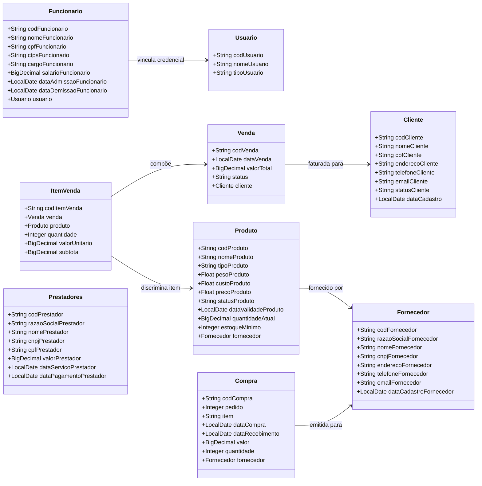
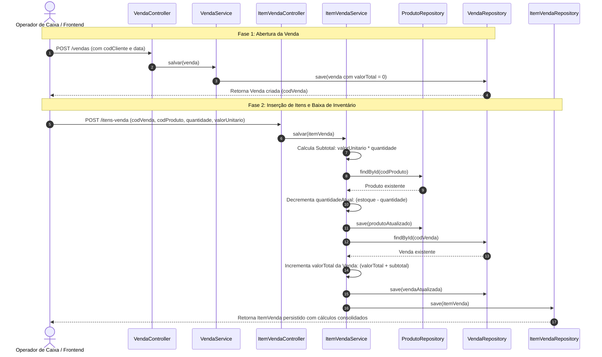
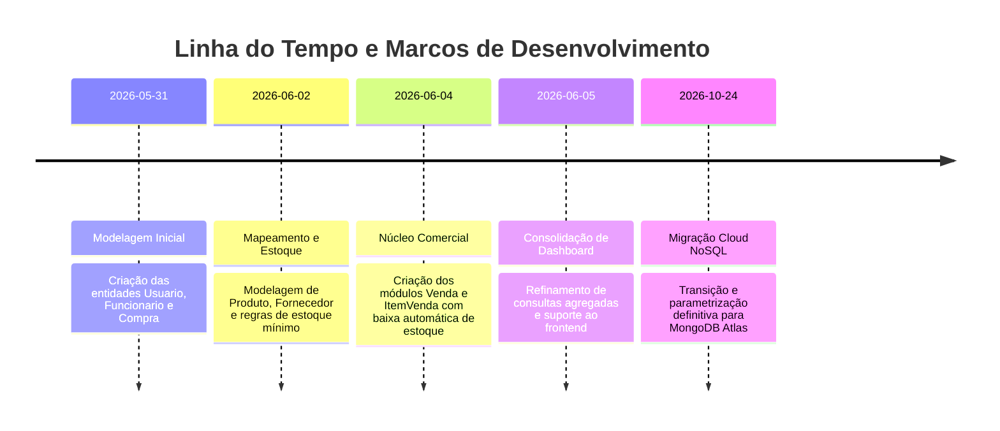

# EasyGest API — Sistema Integrado de Gestão Empresarial (ERP/PME)
> **Projeto Integrador em Desenvolvimento de Software Multiplataforma (DSM)**  
> **Documento de Especificação Técnica e Diário de Bordo Acadêmico**

---

## 1. Introdução e Propósito ("Para Que Serve")

### 1.1. Contextualização e Justificativa Acadêmica
No ecossistema corporativo contemporâneo, a sobrevivência e a escalabilidade de micro, pequenas e médias empresas (PMEs) estão intrinsecamente ligadas à capacidade de administrar fluxos de informação com agilidade, precisão e integridade. Historicamente, essas organizações enfrentam gargalos crônicos decorrentes da fragmentação de dados — controles manuais, uso desarticulado de planilhas eletrônicas e falta de sincronia entre os registros de aquisições, saídas de estoque e conciliação de faturamento. Tais lacunas provocam distorções no fluxo de caixa, episódios frequentes de ruptura de estoque e baixa rastreabilidade operacional.

O **EasyGest** surge como uma resposta a esse desafio, concebido no escopo do Projeto Integrador do curso de Desenvolvimento de Software Multiplataforma (DSM). O sistema visa fornecer uma infraestrutura de backend moderna, padronizada e modular, servindo como o núcleo transacional de um ecossistema de Planejamento de Recursos Empresariais (*Enterprise Resource Planning* - ERP).

### 1.2. Objetivos
* **Objetivo Geral:** Projetar e implementar uma interface de programação de aplicações (API RESTful) escalável e de alto desempenho para orquestrar os processos comerciais, operacionais e de suprimentos de micro e pequenas empresas.
* **Objetivos Específicos:**
  1. Centralizar a persistência de entidades primárias (clientes, fornecedores, prestadores de serviços, colaboradores e usuários do sistema).
  2. Implementar controle dinâmico de catálogo de produtos, integrando métricas de estoque mínimo e alertas de reposição.
  3. Automatizar o ciclo de transações de venda com cálculo algorítmico de subtotais e abatimento atômico no estoque de produtos.
  4. Garantir baixo acoplamento e alta coesão estrutural por meio do padrão arquitetural em camadas e persistência orientada a documentos com MongoDB.

---

## 2. Características do Sistema

### 2.1. Funcionalidades de Negócio
O sistema é estruturado em subdomínios operacionais integrados:

1. **Gestão de Pessoas e Acessos Corporativos:**
   * Cadastro e manutenção de **Usuários** do sistema com classificação de perfis (`tipoUsuario`).
   * Gerenciamento de **Colaboradores (Funcionários)**, incluindo dados trabalhistas (CTPS, cargo, remuneração, datas de admissão e demissão) vinculados a credenciais de usuário.
   * Registro completo de **Clientes**, com histórico cadastral e identificadores fiscais.
2. **Gestão de Fornecedores e Prestadores:**
   * Homologação de **Fornecedores** de mercadorias (razão social, CNPJ, dados de contato e localização).
   * Módulo de **Prestadores de Serviços**, com controle de despesas terceirizadas, prazos de execução e datas de liquidação financeira.
3. **Catálogo de Mercadorias e Monitoramento de Estoque:**
   * Cadastramento de produtos com precificação (custo x venda), peso e data de validade.
   * Associação direta de produtos a fornecedores homologados.
   * Algoritmo de vigilância de inventário com detecção de estoque mínimo para evitar desabastecimento.
4. **Módulo Comercial e Transacional:**
   * Abertura de **Vendas** associadas a clientes com controle de estados (`status`).
   * Adição e remoção granular de **Itens de Venda**, com propagação automática de cálculos financeiros e baixa em tempo de execução no estoque.
5. **Módulo de Aquisições e Suprimentos (Em Consolidação):**
   * Estrutura de dados para registro de ordens de **Compra** de mercadorias, prevendo controle de pedidos, datas de recebimento e custos de reposição.

### 2.2. Requisitos Não-Funcionais e Diretrizes Técnicas
* **Arquitetura Baseada em Recursos (RESTful):** Comunicação padronizada sobre o protocolo HTTP, com respostas serializadas em formato JSON e sem retenção de estado de sessão (*Stateless*).
* **Cross-Origin Resource Sharing (CORS):** Mecanismos de compartilhamento de recursos entre origens devidamente habilitados (`@CrossOrigin(origins = "*")`), permitindo a interoperabilidade transparente com interfaces Web (React/Vue/Angular) e Mobile (React Native/Flutter).
* **Persistência NoSQL Escalável:** Utilização de armazenamento orientado a documentos (MongoDB) em nuvem distribuída (MongoDB Atlas), conferindo alta disponibilidade, tolerância a falhas e flexibilidade de esquema.

---

## 3. Arquitetura do Sistema e Ligações de Integração

### 3.1. Arquitetura em Camadas
A API adota a separação clássica de responsabilidades em três camadas (*Three-Tier Architecture*):



### 3.2. Modelo de Ligação e Relacionamentos entre Domínios
Diferente de bancos de dados puramente relacionais estruturados em chaves estrangeiras rígidas, o **EasyGest** emprega uma modelagem híbrida no MongoDB: mescla **referenciamento** (para manter a consistência de entidades independentes) e **incorporação estruturada (*embedded data*)** para enriquecer as consultas sem sobrecarga transacional.



---

## 4. Dinâmica de Funcionamento ("Como Funciona")

### 4.1. Ciclo de Vida da Operação Comercial e Abatimento de Estoque
O processo mais crítico do sistema reside no fluxo coordenado entre **Venda**, **ItemVenda** e **Produto**, assegurando consistência nas alterações patrimoniais da empresa:



### 4.2. Catálogo de Recursos da API RESTful

| Domínio | Método | Rota HTTP | Descrição Operacional |
| :--- | :---: | :--- | :--- |
| **Usuários** | `GET` | `/usuarios` | Recupera listagem geral de usuários do sistema |
| | `GET` | `/usuarios/{id}` | Busca usuário por identificador primário |
| | `POST` | `/usuarios` | Cadastra novo usuário com credenciais e perfil |
| | `PUT` | `/usuarios/{id}` | Atualiza atributos cadastrais do usuário |
| | `DELETE` | `/usuarios/{id}` | Remove usuário da base de dados |
| **Colaboradores** | `GET` | `/funcionarios` | Lista todos os funcionários e vínculos de usuários |
| | `POST` | `/funcionarios` | Registra colaborador validando vínculo com usuário |
| | `PUT` | `/funcionarios/{id}` | Atualiza dados contratuais e cargo do funcionário |
| | `DELETE` | `/funcionarios/{id}` | Desliga/remove funcionário da base de dados |
| **Clientes** | `GET` | `/clientes` | Lista todos os clientes cadastrados |
| | `POST` | `/clientes` | Cadastra novo cliente (físico/jurídico) |
| | `PUT` | `/clientes/{id}` | Atualiza dados de contato e endereço do cliente |
| | `DELETE` | `/clientes/{id}` | Exclui cliente da base |
| **Fornecedores** | `GET` | `/fornecedores` | Consulta fornecedores homologados |
| | `POST` | `/fornecedores` | Registra novo fornecedor com CNPJ e razão social |
| | `PUT` | `/fornecedores/{id}` | Atualiza cadastro de fornecedor |
| | `DELETE` | `/fornecedores/{id}` | Remove fornecedor da base |
| **Prestadores** | `GET` | `/prestadores` | Lista prestadores de serviços terceirizados |
| | `POST` | `/prestadores` | Registra prestação de serviço, valores e prazos |
| | `PUT` | `/prestadores/{id}` | Atualiza registros de prestação |
| | `DELETE` | `/prestadores/{id}` | Remove registro de prestador |
| **Produtos** | `GET` | `/produtos` | Lista inventário completo de produtos |
| | `GET` | `/produtos/{id}` | Consulta detalhes de um item específico |
| | `POST` | `/produtos` | Cadastra produto e aciona verificação de estoque |
| | `PUT` | `/produtos/{id}` | Atualiza preço, estoque e fornecedor do item |
| | `DELETE` | `/produtos/{id}` | Remove produto do catálogo |
| **Vendas** | `GET` | `/vendas` | Lista todas as vendas e status associados |
| | `POST` | `/vendas` | Inicializa venda vinculando cliente validado |
| | `DELETE` | `/vendas/{id}` | Cancela/exclui registro de venda |
| **Itens Venda** | `GET` | `/itens-venda` | Lista itens registrados em vendas |
| | `POST` | `/itens-venda` | Associa item à venda, calcula subtotal e abate estoque |
| | `DELETE` | `/itens-venda/{id}` | Remove item de venda registrado |

---

## 5. Diário de Bordo de Desenvolvimento (Histórico Evolutivo Acadêmico)

Este diário de bordo documenta formalmente os marcos de evolução arquitetural e funcional da API ao longo do ciclo de vida do projeto:



### 5.1. Registro Cronológico de Marcos
* **Marco 1 — Fundação de Domínio e Gestão de Pessoas (Maio/2026):**
  * Especificação dos modelos canônicos para controle de acessos (`Usuario`) e de recursos humanos (`Funcionario`).
  * Definição da estratégia de integridade para relacionar colaboradores a usuários ativos.
* **Marco 2 — Catálogo de Suprimentos e Regras de Inventário (Junho/2026):**
  * Criação dos domínios `Fornecedor`, `Prestadores` e `Produto`.
  * Implementação da lógica de salvamento e atualização de mercadorias com acionamento de alertas preventivos de ruptura (`quantidadeAtual < estoqueMinimo`).
* **Marco 3 — Núcleo Comercial e Transacional (Junho/2026):**
  * Engenharia do fluxo de pedidos (`Venda` e `ItemVenda`).
  * Implementação do algoritmo sincronizado de baixa de estoque em tempo real e atualização cumulativa do somatório financeiro da venda.
* **Marco 4 — Modernização de Infraestrutura e Conectividade NoSQL (Outubro/2026):**
  * Migração estrutural da camada de persistência para o **MongoDB Atlas**, usufruindo de alta disponibilidade gerenciada e redução de atrito na persistência de documentos aninhados.
  * Padronização de endpoints e isolamento das credenciais operacionais.

---

## 6. Pilha Tecnológica (*Tech Stack*)

* **Linguagem de Programação:** Java 21 LTS (Long-Term Support)
* **Framework Principal:** Spring Boot 4.0.x / 3.x
  * *Spring Web MVC*: Construção de controladores RESTful e serialização JSON.
  * *Spring Data MongoDB*: Abstração de repositórios orientados a documentos e geração de queries dinâmicas.
  * *Spring Security*: Autenticação HTTP Basic para os endpoints REST.
  * *Jakarta Bean Validation*: Validação dos dados de entrada dos endpoints.
  * *Spring Boot DevTools*: Otimização do ciclo de compilação em ambiente de desenvolvimento.
* **Ferramenta de Suporte e Produtividade:** Project Lombok (eliminação de boilerplate: `@Getter`, `@Setter`, construtores).
* **Banco de Dados:** MongoDB Atlas (NoSQL orientado a documentos na nuvem).
* **Gerenciador de Dependências e Build:** Apache Maven 3.9+.

---

## 7. Instruções para Execução do Ambiente de Desenvolvimento

### 7.1. Pré-Requisitos de Ambiente
* **Java Development Kit (JDK):** Versão 21 ou superior instalada e configurada nas variáveis de ambiente (`JAVA_HOME`).
* **Apache Maven:** Versão 3.9+ (ou utilização do script empacotado `mvnw` / `mvnw.cmd`).
* **Conectividade:** Acesso à internet para resolução de dependências no repositório Maven Central e tráfego TLS com o cluster MongoDB Atlas.

### 7.2. Inicialização da Aplicação
Clone o repositório e execute a suíte de inicialização padrão:

```bash
# Clone do repositório
git clone https://github.com/leognobrega/API_Easygest.git
cd API_Easygest

# Compilação e execução via Maven Wrapper (Windows PowerShell)
.\mvnw.cmd spring-boot:run

# Linux/macOS (o wrapper do projeto não precisa estar marcado como executável)
bash ./mvnw spring-boot:run

# Ou via Maven instalado no sistema operacional
mvn spring-boot:run
```

A aplicação inicializará por padrão na porta `8080`. Os endpoints estarão acessíveis a partir do prefixo base `http://localhost:8080/`.

### 7.3. Segurança e validação da API

A API usa **HTTP Basic**, sem JWT. Todos os endpoints exigem autenticação; somente requisições CORS `OPTIONS` são liberadas para preflight. A API é stateless e CSRF está desabilitado para este uso REST. Configure as credenciais localmente no arquivo `.env.local` (não versionado):

```properties
SPRING_MONGODB_URI=<sua-uri-do-mongodb>
EASYGEST_SECURITY_USERNAME=<seu-usuario>
EASYGEST_SECURITY_PASSWORD=<uma-senha-forte>
```

Não reutilize credenciais de exemplo nem envie o arquivo `.env.local` ao repositório. Em produção, use HTTPS e forneça os valores por um gerenciador de segredos.

#### Deploy no Render

O projeto inclui um `render.yaml`. No serviço ou Blueprint do Render, configure obrigatoriamente estas variáveis de ambiente:

```properties
SPRING_MONGODB_URI=<uri-mongodb-com-banco>
EASYGEST_SECURITY_USERNAME=<usuario-da-api>
EASYGEST_SECURITY_PASSWORD=<senha-forte-da-api>
EASYGEST_CORS_ALLOWED_ORIGINS=<origem-frontend>,<outra-origem-opcional>
```

O Dockerfile usa Java 21 e o Spring Boot recebe automaticamente a porta fornecida pelo Render por meio da variável `PORT`. Não defina uma porta fixa em produção. Para liberar apenas um frontend, informe a URL completa sem barra final, por exemplo `https://easygest.vercel.app`.

No Postman, selecione **Authorization → Basic Auth**, informe o usuário e a senha configurados e envie as requisições para `http://localhost:8080`. Por exemplo, para cadastrar produto:

```http
POST http://localhost:8080/produtos
Content-Type: application/json
```

Os endpoints de criação e atualização usam Jakarta Bean Validation (`@Valid`). Os campos obrigatórios e valores negativos inválidos retornam HTTP `400`; uma requisição sem credenciais válidas retorna HTTP `401`.

**Recursos utilizados:** `spring-boot-starter-security` e `spring-boot-starter-validation`, gerenciados pelo Spring Boot e resolvidos via Maven Central; configuração de segurança em `SecurityConfig`; restrições declarativas nos modelos recebidos e ativação nos controllers.

**Escopo implementado:** autenticação compartilhada em memória, configurada por ambiente (não é um login por usuário MongoDB); validações de campos obrigatórios, e-mail, quantidades e valores não negativos nos módulos de Cliente, Fornecedor, Funcionário, Prestador, Produto, Usuário, Venda e ItemVenda.

**Módulos que ainda precisam de validação/testes:** Compra ainda não possui controller/endpoint; testar todas as rotas CRUD com MongoDB e credenciais; definir regras fiscais de CPF/CNPJ/telefone e consistência de datas; validar permissões por perfil (atualmente qualquer usuário Basic Auth autenticado recebe o mesmo papel); e cobrir regras transacionais de estoque e vendas com testes de integração.

---

## 8. Considerações Acadêmicas e Autoria
Projeto desenvolvido por **Leonardo Nóbrega** no âmbito acadêmico do curso de **Desenvolvimento de Software Multiplataforma (DSM)**. Destina-se ao estudo, validação e aplicação prática de conceitos avançados de engenharia de software para a web, arquiteturas de microsserviços e persistência heterogênea.

---

## 1. Introdução e Propósito ("Para Que Serve")

### 1.1. Contextualização e Justificativa Acadêmica
No ecossistema corporativo contemporâneo, a sobrevivência e a escalabilidade de micro, pequenas e médias empresas (PMEs) estão intrinsecamente ligadas à capacidade de administrar fluxos de informação com agilidade, precisão e integridade. Historicamente, essas organizações enfrentam gargalos crônicos decorrentes da fragmentação de dados — controles manuais, uso desarticulado de planilhas eletrônicas e falta de sincronia entre os registros de aquisições, saídas de estoque e conciliação de faturamento. Tais lacunas provocam distorções no fluxo de caixa, episódios frequentes de ruptura de estoque e baixa rastreabilidade operacional.

O **EasyGest** surge como uma resposta a esse desafio, concebido no escopo do Projeto Integrador do curso de Desenvolvimento de Software Multiplataforma (DSM). O sistema visa fornecer uma infraestrutura de backend moderna, padronizada e modular, servindo como o núcleo transacional de um ecossistema de Planejamento de Recursos Empresariais (*Enterprise Resource Planning* - ERP).

### 1.2. Objetivos
* **Objetivo Geral:** Projetar e implementar uma interface de programação de aplicações (API RESTful) escalável e de alto desempenho para orquestrar os processos comerciais, operacionais e de suprimentos de micro e pequenas empresas.
* **Objetivos Específicos:**
  1. Centralizar a persistência de entidades primárias (clientes, fornecedores, prestadores de serviços, colaboradores e usuários do sistema).
  2. Implementar controle dinâmico de catálogo de produtos, integrando métricas de estoque mínimo e alertas de reposição.
  3. Automatizar o ciclo de transações de venda com cálculo algorítmico de subtotais e abatimento atômico no estoque de produtos.
  4. Garantir baixo acoplamento e alta coesão estrutural por meio do padrão arquitetural em camadas e persistência orientada a documentos com MongoDB.

---

## 2. Características do Sistema

### 2.1. Funcionalidades de Negócio
O sistema é estruturado em subdomínios operacionais integrados:

1. **Gestão de Pessoas e Acessos Corporativos:**
   * Cadastro e manutenção de **Usuários** do sistema com classificação de perfis (`tipoUsuario`).
   * Gerenciamento de **Colaboradores (Funcionários)**, incluindo dados trabalhistas (CTPS, cargo, remuneração, datas de admissão e demissão) vinculados a credenciais de usuário.
   * Registro completo de **Clientes**, com histórico cadastral e identificadores fiscais.
2. **Gestão de Fornecedores e Prestadores:**
   * Homologação de **Fornecedores** de mercadorias (razão social, CNPJ, dados de contato e localização).
   * Módulo de **Prestadores de Serviços**, com controle de despesas terceirizadas, prazos de execução e datas de liquidação financeira.
3. **Catálogo de Mercadorias e Monitoramento de Estoque:**
   * Cadastramento de produtos com precificação (custo x venda), peso e data de validade.
   * Associação direta de produtos a fornecedores homologados.
   * Algoritmo de vigilância de inventário com detecção de estoque mínimo para evitar desabastecimento.
4. **Módulo Comercial e Transacional:**
   * Abertura de **Vendas** associadas a clientes com controle de estados (`status`).
   * Adição e remoção granular de **Itens de Venda**, com propagação automática de cálculos financeiros e baixa em tempo de execução no estoque.
5. **Módulo de Aquisições e Suprimentos (Em Consolidação):**
   * Estrutura de dados para registro de ordens de **Compra** de mercadorias, prevendo controle de pedidos, datas de recebimento e custos de reposição.

### 2.2. Requisitos Não-Funcionais e Diretrizes Técnicas
* **Arquitetura Baseada em Recursos (RESTful):** Comunicação padronizada sobre o protocolo HTTP, com respostas serializadas em formato JSON e sem retenção de estado de sessão (*Stateless*).
* **Cross-Origin Resource Sharing (CORS):** Mecanismos de compartilhamento de recursos entre origens devidamente habilitados (`@CrossOrigin(origins = "*")`), permitindo a interoperabilidade transparente com interfaces Web (React/Vue/Angular) e Mobile (React Native/Flutter).
* **Persistência NoSQL Escalável:** Utilização de armazenamento orientado a documentos (MongoDB) em nuvem distribuída (MongoDB Atlas), conferindo alta disponibilidade, tolerância a falhas e flexibilidade de esquema.

---

## 3. Arquitetura do Sistema e Ligações de Integração

### 3.1. Arquitetura em Camadas
A API adota a separação clássica de responsabilidades em três camadas (*Three-Tier Architecture*):


### 3.2. Modelo de Ligação e Relacionamentos entre Domínios
Diferente de bancos de dados puramente relacionais estruturados em chaves estrangeiras rígidas, o **EasyGest** emprega uma modelagem híbrida no MongoDB: mescla **referenciamento** (para manter a consistência de entidades independentes) e **incorporação estruturada (*embedded data*)** para enriquecer as consultas sem sobrecarga transacional.


---

## 4. Dinâmica de Funcionamento ("Como Funciona")

### 4.1. Ciclo de Vida da Operação Comercial e Abatimento de Estoque
O processo mais crítico do sistema reside no fluxo coordenado entre **Venda**, **ItemVenda** e **Produto**, assegurando consistência nas alterações patrimoniais da empresa:


### 4.2. Catálogo de Recursos da API RESTful

| Domínio | Método | Rota HTTP | Descrição Operacional |
| :--- | :---: | :--- | :--- |
| **Usuários** | `GET` | `/usuarios` | Recupera listagem geral de usuários do sistema |
| | `GET` | `/usuarios/{id}` | Busca usuário por identificador primário |
| | `POST` | `/usuarios` | Cadastra novo usuário com credenciais e perfil |
| | `PUT` | `/usuarios/{id}` | Atualiza atributos cadastrais do usuário |
| | `DELETE` | `/usuarios/{id}` | Remove usuário da base de dados |
| **Colaboradores** | `GET` | `/funcionarios` | Lista todos os funcionários e vínculos de usuários |
| | `POST` | `/funcionarios` | Registra colaborador validando vínculo com usuário |
| | `PUT` | `/funcionarios/{id}` | Atualiza dados contratuais e cargo do funcionário |
| | `DELETE` | `/funcionarios/{id}` | Desliga/remove funcionário da base de dados |
| **Clientes** | `GET` | `/clientes` | Lista todos os clientes cadastrados |
| | `POST` | `/clientes` | Cadastra novo cliente (físico/jurídico) |
| | `PUT` | `/clientes/{id}` | Atualiza dados de contato e endereço do cliente |
| | `DELETE` | `/clientes/{id}` | Exclui cliente da base |
| **Fornecedores** | `GET` | `/fornecedores` | Consulta fornecedores homologados |
| | `POST` | `/fornecedores` | Registra novo fornecedor com CNPJ e razão social |
| | `PUT` | `/fornecedores/{id}` | Atualiza cadastro de fornecedor |
| | `DELETE` | `/fornecedores/{id}` | Remove fornecedor da base |
| **Prestadores** | `GET` | `/prestadores` | Lista prestadores de serviços terceirizados |
| | `POST` | `/prestadores` | Registra prestação de serviço, valores e prazos |
| | `PUT` | `/prestadores/{id}` | Atualiza registros de prestação |
| | `DELETE` | `/prestadores/{id}` | Remove registro de prestador |
| **Produtos** | `GET` | `/produtos` | Lista inventário completo de produtos |
| | `GET` | `/produtos/{id}` | Consulta detalhes de um item específico |
| | `POST` | `/produtos` | Cadastra produto e aciona verificação de estoque |
| | `PUT` | `/produtos/{id}` | Atualiza preço, estoque e fornecedor do item |
| | `DELETE` | `/produtos/{id}` | Remove produto do catálogo |
| **Vendas** | `GET` | `/vendas` | Lista todas as vendas e status associados |
| | `POST` | `/vendas` | Inicializa venda vinculando cliente validado |
| | `DELETE` | `/vendas/{id}` | Cancela/exclui registro de venda |
| **Itens Venda** | `GET` | `/itens-venda` | Lista itens registrados em vendas |
| | `POST` | `/itens-venda` | Associa item à venda, calcula subtotal e abate estoque |
| | `DELETE` | `/itens-venda/{id}` | Remove item de venda registrado |

---

## 5. Diário de Bordo de Desenvolvimento (Histórico Evolutivo Acadêmico)

Este diário de bordo documenta formalmente os marcos de evolução arquitetural e funcional da API ao longo do ciclo de vida do projeto:


### 5.1. Registro Cronológico de Marcos
* **Marco 1 — Fundação de Domínio e Gestão de Pessoas (Maio/2026):**
  * Especificação dos modelos canônicos para controle de acessos (`Usuario`) e de recursos humanos (`Funcionario`).
  * Definição da estratégia de integridade para relacionar colaboradores a usuários ativos.
* **Marco 2 — Catálogo de Suprimentos e Regras de Inventário (Junho/2026):**
  * Criação dos domínios `Fornecedor`, `Prestadores` e `Produto`.
  * Implementação da lógica de salvamento e atualização de mercadorias com acionamento de alertas preventivos de ruptura (`quantidadeAtual < estoqueMinimo`).
* **Marco 3 — Núcleo Comercial e Transacional (Junho/2026):**
  * Engenharia do fluxo de pedidos (`Venda` e `ItemVenda`).
  * Implementação do algoritmo sincronizado de baixa de estoque em tempo real e atualização cumulativa do somatório financeiro da venda.
* **Marco 4 — Modernização de Infraestrutura e Conectividade NoSQL (Outubro/2026):**
  * Migração estrutural da camada de persistência para o **MongoDB Atlas**, usufruindo de alta disponibilidade gerenciada e redução de atrito na persistência de documentos aninhados.
  * Padronização de endpoints e isolamento das credenciais operacionais.

---

## 6. Pilha Tecnológica (*Tech Stack*)

* **Linguagem de Programação:** Java 21 LTS (Long-Term Support)
* **Framework Principal:** Spring Boot 4.0.x / 3.x
  * *Spring Web MVC*: Construção de controladores RESTful e serialização JSON.
  * *Spring Data MongoDB*: Abstração de repositórios orientados a documentos e geração de queries dinâmicas.
  * *Spring Boot DevTools*: Otimização do ciclo de compilação em ambiente de desenvolvimento.
* **Ferramenta de Suporte e Produtividade:** Project Lombok (eliminação de boilerplate: `@Getter`, `@Setter`, construtores).
* **Banco de Dados:** MongoDB Atlas (NoSQL orientado a documentos na nuvem).
* **Gerenciador de Dependências e Build:** Apache Maven 3.9+.

---

## 7. Instruções para Execução do Ambiente de Desenvolvimento

### 7.1. Pré-Requisitos de Ambiente
* **Java Development Kit (JDK):** Versão 21 ou superior instalada e configurada nas variáveis de ambiente (`JAVA_HOME`).
* **Apache Maven:** Versão 3.9+ (ou utilização do script empacotado `mvnw` / `mvnw.cmd`).
* **Conectividade:** Acesso à internet para resolução de dependências no repositório Maven Central e tráfego TLS com o cluster MongoDB Atlas.

### 7.2. Inicialização da Aplicação
Clone o repositório e execute a suíte de inicialização padrão:

```bash
# Clone do repositório
git clone https://github.com/leognobrega/API_Easygest.git
cd API_Easygest

# Compilação e execução via Maven Wrapper (Windows PowerShell)
.\mvnw.cmd spring-boot:run

# Ou via Maven instalado no sistema operacional
mvn spring-boot:run
```

A aplicação inicializará por padrão na porta `8080`. Os endpoints estarão acessíveis a partir do prefixo base `http://localhost:8080/`.

---

## 8. Considerações Acadêmicas e Autoria
Projeto desenvolvido por **Leonardo Nóbrega** no âmbito acadêmico do curso de **Desenvolvimento de Software Multiplataforma (DSM)**. Destina-se ao estudo, validação e aplicação prática de conceitos avançados de engenharia de software para a web, arquiteturas de microsserviços e persistência heterogênea.
