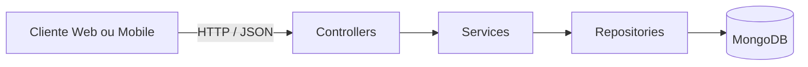

# EasyGest API

API backend para um sistema de gestão empresarial voltado a micro e pequenas empresas. O projeto integra cadastros, produtos, estoque e vendas em uma aplicação REST, desenvolvida como parte do Projeto Integrador do curso de Desenvolvimento de Software Multiplataforma (DSM).

## Sobre o projeto

O EasyGest busca centralizar informações administrativas e comerciais que, em pequenos negócios, muitas vezes são controladas em ferramentas separadas. A API disponibiliza recursos para organizar dados de clientes, usuários, funcionários, fornecedores, prestadores de serviços, produtos e vendas.

Este repositório contém o backend da aplicação. Os dados são persistidos no MongoDB, e as funcionalidades são organizadas em uma arquitetura em camadas para separar o acesso HTTP, as regras de negócio e a persistência.

## Funcionalidades

- Cadastro e consulta de usuários, funcionários e clientes.
- Gestão de fornecedores e prestadores de serviços.
- Cadastro de produtos, com informações de preço e estoque mínimo.
- Registro de vendas e itens de venda, com atualização de valores e estoque.
- Validação de dados recebidos pela API.
- Proteção dos endpoints com autenticação HTTP Basic.

## Tecnologias

| Tecnologia | Uso |
| --- | --- |
| Java 21 | Linguagem de programação |
| Spring Boot 4 | Framework da aplicação |
| Spring Web MVC | Criação da API REST |
| Spring Data MongoDB | Persistência de dados |
| Spring Security | Autenticação HTTP Basic |
| Jakarta Bean Validation | Validação de entradas |
| Maven | Gerenciamento de dependências e build |

## Arquitetura



- **Controllers:** recebem as requisições HTTP e encaminham as operações.
- **Services:** concentram regras de negócio e validações.
- **Repositories:** abstraem o acesso aos documentos armazenados no MongoDB.

## Recursos da API

Os recursos seguem o padrão REST e, quando aplicável, oferecem operações de consulta, criação, atualização e remoção.

| Recurso | Rota base |
| --- | --- |
| Usuários | `/usuarios` |
| Funcionários | `/funcionarios` |
| Clientes | `/clientes` |
| Fornecedores | `/fornecedores` |
| Prestadores de serviços | `/prestadores` |
| Produtos | `/produtos` |
| Vendas | `/vendas` |
| Itens de venda | `/itens-venda` |

As operações disponíveis podem variar entre recursos. As requisições e respostas utilizam JSON.

## Execução local

### Pré-requisitos

- JDK 21 ou superior.
- MongoDB acessível pela aplicação.
- Git.

### Configuração

Configure as variáveis de ambiente abaixo antes de iniciar a aplicação. O arquivo `.env.local` pode ser usado no desenvolvimento local e não deve ser enviado ao repositório.

```properties
SPRING_MONGODB_URI=<uri-de-conexao-do-mongodb>
EASYGEST_SECURITY_USERNAME=<usuario-da-api>
EASYGEST_SECURITY_PASSWORD=<senha-da-api>
```

### Inicialização

```bash
git clone https://github.com/leognobrega/API_Easygest.git
cd API_Easygest
```

No Windows:

```powershell
.\mvnw.cmd spring-boot:run
```

No Linux ou macOS:

```bash
./mvnw spring-boot:run
```

Por padrão, a aplicação é iniciada em `http://localhost:8080`. As rotas protegidas exigem autenticação HTTP Basic usando as credenciais configuradas no ambiente.

## Contexto acadêmico

O EasyGest é desenvolvido no âmbito do curso de **Desenvolvimento de Software Multiplataforma (DSM)**. O projeto aplica conceitos de desenvolvimento de APIs REST, arquitetura em camadas, persistência de documentos e organização de processos de gestão empresarial.
